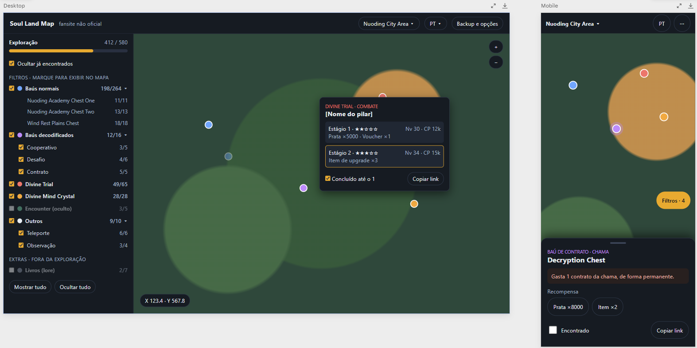

# Soul Land Map — MVP Specification

Draft for review · November 12, 2026

## 1. Overview

An unofficial fansite for *Soul Land: New World* featuring interactive maps in the style of MapGenie. The MVP has a single core function: viewing a regional map with filterable markers (chests, crystals, Divine Trials, Encounters, teleporters, and other points of interest) and tracking one’s own exploration progress. The project was conceived because, currently, players aiming for 100% exploration must hunt down dozens of individual videos, each covering only a minor detail.

Principles:

- 100% static site hosted on GitHub Pages; open repository (for portfolio purposes).
- Simple HTML + JS using Leaflet.js; no build step required. Leaflet is included as a vendor dependency; ES modules are used.
- Data stored in JSON files (one per map) and version-controlled within the repository. A spreadsheet serves as the "source of truth" only until the MVP stage; thereafter, the JSON files take over.
- Avoid over-engineering: introduce new infrastructure only when a genuine need arises.
- Internationalization (i18n) from the start: English (default/fallback), Portuguese, and Chinese.

## 2. Scope

Included in the MVP:

- Region selector (8 regions planned; *Nuoding City Area* to be implemented first).
- Filter sidebar with counters, detail popups, "mark as found" functionality, and an option to hide found items.
- Exploration progress tracked via `localStorage`, with JSON-based backup and restore features.
- Language selector, deep-linking via URL hash, and a mobile-responsive layout.
- In-game coordinate display (tracking the cursor's position to validate calibration and assist with data debugging).

Excluded from the MVP: search functionality; marker clustering (not necessary for ~300 markers per map); user-added notes or custom markers; an editor mode (handled by the spreadsheet); exploration point calculators; merchant/pricing data; and filtering by access-based tags. expected reward value; community contribution; cross-device synchronization.

Books (lore) are included in the MVP, though not all need to be listed at launch.

## 3. Repository structure

```text
index.html
js/                      ES modules (app, map, filters, popup, progress, i18n)
vendor/leaflet/          Vendorized Leaflet
css/
icons/                   Only the icons actually in use
data/
maps.json              Regions, image dimensions, calibration
categories.json        Groups, subtypes, icon, color, default loot
items.json             Item catalog (icon)
loot.json              Reusable loot tables
entries/<map>.json     Exploration list entries
markers/<map>.json     Markers
i18n/
en.json pt.json zh.json              UI and categories
items.<lang>.json                    Item names
entries.<map>.<lang>.json            Entry names and descriptions
markers.<map>.<lang>.json            Marker text
tiles/<map>/{z}/{x}/{y}.webp
tools/                   Python: CSV → JSON, validation, tile generation
```

## 4. Data model

### 4.1 Maps and calibration

`maps.json` stores the following for each map: ID, name (i18n), image width and height (4096 × 4096 for Nuoding), native tile zoom levels, and calibration data.

Calibration consists of two independent linear equations (no rotation), validated using approximately 10 points in Nuoding. The scale is 25/7 pixels per in-game unit (≈ 3.6 px). Store as `scaleX`, `offsetX`, `scaleY`, and `offsetY`. In-game Y-coordinates increase from bottom to top, matching the Y-axis behavior of Leaflet’s `CRS.Simple`; verify the sign convention using a known marker before populating the rest of the data. Markers store coordinates in in-game units, never in pixels. Consequently, adjusting the calibration or changing the background image does not require regenerating the markers, and the data remains verifiable against the game. Since the [Location] link ensures the character stops precisely at the designated point, the coordinate recorded upon arrival is accurate.

There is no Z-axis: the game features no distinct vertical levels (floors), and no two points ever share the same X/Y coordinates. In the rare instances where verticality exists (e.g., a cave beneath a plateau or the roof of a building), this distinction is noted in the text description.

### 4.2 Categories

The game’s exploration UI consists of 6 categories; the website mirrors these as top-level groups, with subtypes nested underneath:

- Normal Chest: chest_normal.
- Decryption Chest: chest_coop, chest_challenge, chest_contract.
- Divine Trial: divine_trial (tracked by stage).
- Divine Mind Crystal: crystal.
- Encounter: encounter.
- Other: teleport, viewpoint, seed.

Excluded from the checksum and the exploration progress bar are "extras" (books, lore) and "auxiliary" items (mechanisms and other supporting markers). Dragon Island has its own specific types (see section 4.9).

The `categories.json` file defines the following for each category and subtype: group, icon, color, whether it contributes to exploration progress, and its default loot.

### 4.3 Exploration Entries

Each region contains a list of entries, corresponding directly to the list found in the game’s exploration UI. An entry consists of an ID, a type (matching the marker type—see `marker.type`), an expected size, optional tags, and official text (name and description) managed via i18n. Entry IDs are unique per map rather than globally; the same slug may appear on different maps (e.g., `light-up-teleport`), meaning an entry is uniquely identified by the pair (map, slug).

```json
{ "tang-sect-2": { "type": "chest_normal", "size": 17, "tags": ["purple_demon_eye"] } }
```

In the Nuoding City Area:

- 20 sets of normal chests, totaling 264, which encompass all normal chests. Therefore, an "entry" field is mandatory for `chest_normal`.
- 16 individual chests, each constituting a single-item entry, officially designated as: 4 Cooperative Chests, 6 Pillars of the Empty Path, and 6 Coffers.
- 6 sets of crystals, totaling 28.
- 5 Encounters, each constituting a single entry.
- 2 entries under "Other": "Light Up! Teleport" (6) and "Enjoy the Scenery" (4).
- Divine Trials do not appear in the in-game list and have no corresponding entry.

Sets carry semantic meaning beyond mere geography. Defined tags include: `grappling_hook` (Tang Sect Chest One), `purple_demon_eye` (Tang Sect Chest Two and Three), `guarded` (Guardian Chest), and `hidden` (Hidden Chest I and II). Filtering by tag is planned for a post-MVP phase, but the data is included in the catalog now.

### 4.4 Markers: Common Fields

- `id`: Immutable; assigned once in the spreadsheet and never reused (e.g., `nuoding-0142`). Never derive this from a row number, coordinates, or type.
- `type`, `x`, and `y`: Coordinates in in-game units.
- `entry`: The ID of the exploration entry to which it belongs, if applicable.
- `entryIndex`: The position of the point within the `[Location N]` sequence as found in the game's "Answer" (solution/guide) section.
- `links`: IDs of related markers (represented as bidirectional links in the UI).
- `note`: A short, optional text field. Longer texts should be placed in the marker's i18n (internationalization) data.

"Normal chest" markers do not specify rewards; these are derived from the category's standard loot table.

### 4.5 Marker Types

- `chest_normal`: Counts toward the "Normal Chest" category. Loot: `normal_chest` table.
- `chest_coop`: For 2 to 4 players. The mechanism (e.g., holding down a button) is defined as text in the `i18n` file. It has its own specific rewards.
- `chest_challenge`: A chest associated with the "Pillars of Empty Path" (a jumping puzzle). The `location` field points to the chest, not the pillar; the pillar's position is optional and defined inline via the `pillar` field (with `x` and `y` coordinates). When the popup is open, the map displays a small pin on the pillar, connected to the chest by a dashed line.
- `chest_contract`: Includes a `contract` field (wood, flame, or frost) and a `cost` field specifying the required contract item: Dragonwood (wood; 3 required in Nuoding), Desolate Flame (flame; 2 required), or Mysterious Frost (frost; 1 required). The "pact stone" surrounds the chest and shares the same position, so a single set of coordinates suffices. The popup warns that the contract item is permanently consumed.
- `crystal`: Divine Mind Crystal—a floating orange cube.
- `divine_trial`: See section 4.6.
- `encounter`: See section 4.7.
- Teleport and viewpoint: Teleportation points and observation points. A portal (appearing as a vortex) that leads to another region—such as the one connecting Dragon Island to the Tian Dou City area—is classified as a `portal` type, with a `to` field pointing to the destination map; these are stored in an auxiliary group, separate from the standard counters.
- `seed`: A Blue Silver Grass seed (found in the "Mixed Area"). Includes a `seed` field corresponding to the number displayed by the game upon collection (e.g., 2). Since this may differ from the `entryIndex`, both values are saved. The `location` field points to the spot where the interaction begins.
- `mechanism`: A magical mechanism located near each seed; it creates a bridge and can only be activated using the correct seed. It includes a `requiresSeed` field that links to the corresponding seed. This is treated as a distinct marker, stored in an auxiliary group outside the main counters, as players must discover it independently, and its effect requires a description in the `i18n` file. - Book: Lore book, additional group.
- Boss and arena: Dragon Island (section 4.9).

### 4.6 Divine Trial

One marker per pillar, with a `subtype` of either "puzzle" or "combat" and a list of `stages`. The in-game counter tracks progress by stage (e.g., Nuoding: 65), so the site’s counter aggregates these stages.

```json
{ "id": "nuoding-0412", "type": "divine_trial", "subtype": "combat", "x": 123.4, "y": 567.8,
"stages": [ { "stars": 2, "level": 30, "cp": 12000, "reward": [ { "item": "silver", "qty": 5000 } ] } ] }
```

- Stages are sequential: starting at 1, then 2, and so on. Progress is represented as an integer (number of completed stages)—for example, 6/10—with the user manually specifying how many stages they have completed.
- The `stars` value ranges from 1 to 5, applicable to both puzzle and combat types.
- `level` and `cp` fields exist only for combat trials; they are omitted for puzzle trials, in which case the client defaults to level 1 and CP 0.
- Each stage has its own set of rewards, consisting of 2 to 4 items.
- The name of the pillar (the trial's theme) is handled via the marker's i18n data. Individual stages do not have names or descriptions.
- Since each combat stage requires a different level, the popup highlights the next available stage. Filtering by player level is a feature for a later update.

### 4.7 Encounters

Hidden quests activated by a trigger. Response formats in the game are not uniform: "Andy's Dilemma" provides a [Location], but the actual trigger (speaking to the NPC multiple times in a row) does not appear in the text; "Animal Protection" contains no links and describes three rescue points.

- points: a list of points with x and y coordinates (one or several). The marker counts once toward the total, regardless of the number of points.
- Texts in i18n: "hint" (the official in-game description, always visible) and "howto" (custom text, hidden behind a "show solution" button).
- reward: rewards granted upon completion.
- Progress is tracked by marker ID.

### 4.8 Rewards, items, and loot

A reward list accepts three types of input:

```json
[ { "item": "crystal", "qty": 20 },
{ "item": "silver", "qty": 500, "chance": 0.25 },
{ "oneOf": [ { "weight": 80, "items": [ { "item": "mind_method_r", "qty": 2 } ] },
{ "weight": 20, "items": [ { "item": "mind_method_sr", "qty": 1 } ] } ] } ]
```

- Fixed: item and qty.
- Independent random: with a chance factor.
- Exclusive choice: `oneOf` with `weight` (in %), totaling 100. This is the case for the "Mind Method" in standard chests: an 80% chance for 2 × R-tier items, or a 20% chance for 1 × SR-tier item.

`loot.json` stores named tables. All standard chests in the game—across every region—follow the same pattern; therefore, a single `normal_chest` table exists, which is referenced by `categories.json`. A marker can override this by specifying a `loot` table name or an inline `reward` definition; this is used for special chests, which always contain the same fixed rewards.

One of the fixed rewards in standard chests is a random piece of equipment tailored to the player's class, which scales based on the player's level (never the region). This is modeled as `{ item: class_equipment, qty: 1, scales: player_level }`. In the MVP, the UI popup simply indicates that the equipment varies according to the player's level. The specific level thresholds are currently unknown; once discovered, they will be added as tiers in `items.json` without requiring any changes to the markers. This is a low-priority task, even in the long term: such equipment is intentionally inferior to items obtained from dungeons, paid bundles, or crafting, and can be dismantled into currency and upgrade materials.

`items.json` serves as the catalog (defining the icon for each item), while the names are stored in `i18n/items.<lang>.json`. There are approximately 10 to 20 distinct items. ...in Divine Trials (silver coins, gacha pull vouchers, game system upgrade items), plus crystals, contracts, Mind Methods, and abstract equipment. Game rewards are considered immutable; should they change, the corresponding entry in `loot.json` is updated.

### 4.9 Dragon Island

This is a single map with no exploration mechanics, making it a low priority. The game provides two versions of the same map with identical markers: Dragon Island (Combat Zone, open PvP) and Dragon Island (Safe Zone, no PvP).

- A single set of markers is used, with a "Combat/Safe" toggle in the header—a feature unique to this map.
- Types: Bosses (9 bosses scattered across the map, each with a fixed respawn location) and Arena (Ancient Tooth Peak, used for world boss events at specific times).
- Each of the 9 bosses always spawns in the same location; the location name corresponds to the area label on the in-game map. Each boss has a unique name and belongs to a specific species—bosses of the same species drop the same "soul ring," and their individual names do not affect their attributes or combat style.
- There is no checksum or exploration progress bar. The map also features a teleporter near Silent Beach (Safe Zone), next to which lies a swirling portal leading to the Tian Dou City Area. As with other maps, the coordinates for all points of interest are gathered by visiting the locations and recording their X and Y values.

| Spawn Location | Boss | Species |
| --- | --- | --- |
| Broken Tooth Reefs | Sly Supreme Orangutan | Supreme Orangutan |
| North Coast Beach | Combatant Diamond Mammoth | Diamond Mammoth |
| Thunder's Edge | Sly Mighty Kong Bear | Supreme Bear |
| West Coast Beach | Combatant Supreme Bear | Supreme Bear |
| East Coast Beach | Combatant Supreme Orangutan | Supreme Orangutan |
| South Coast Beach | Sly Supreme Orangutan | Supreme Orangutan |
| Hope Island | Sly Wolf Thief Leader | Wolf Thief |
| Soul Rest Island (north) | Combatant Wolf Thief Leader | Wolf Thief |
| Soul Rest Island (south) | Sly Diamond Mammoth | Diamond Mammoth |

For boss markers, the "species" field stores the species type (there are four on Dragon Island), while the names are handled via i18n. The sidebar allows filtering by species—since the "soul ring" depends on it—and the popup lists other locations where the same species can be found.

## 5. i18n

- Languages: en (default/fallback), pt, and zh. If any text or data is missing in the selected language, it defaults to en. Future plans include a mechanism for users to suggest translations or corrections.
- Data JSON files are language-agnostic. All text resides in i18n files, indexed by ID.
- Titles for common markers are derived from their type (e.g., "Common Chest") and do not require individual text entries.
- The game’s official English localization is inconsistent (e.g., "Norton" vs. "Nuoding," "Fugold" vs. "Floating Gold," and "Sunset Forest" vs. "Radiant Light Forest"). To address this, IDs are kept independent of names; the Chinese version serves as the "source of truth" whenever available, and the site’s i18n layer can be used to correct the official English terminology.
- The selected language is persisted in the settings.

## 6. Progress and localStorage

- Keys include a prefix and version. Progress is tracked per map: `slmap:v1:progress:<map>`, containing `found` (a list of IDs) and `trials` (a mapping of IDs to completed stages). Settings are stored under `slmap:v1:settings`, covering language, "hide found" status, the current map, visible categories per map, and the center/zoom coordinates for each map.
- All read and write operations are wrapped in `try/catch` blocks; the site must remain functional even if storage is empty or unavailable.
- Backup and restore: a feature to export/import a JSON file containing the app, version, progress, and settings. This mitigates data loss when clearing browser storage or switching devices, without requiring a backend.
- Stable IDs ensure that progress persists through data updates. IDs removed in a patch are simply ignored during data retrieval.
- Changes to the data format require incrementing the version number and implementing a migration script.

## 7. Interface

Foundation: Based on the MapGenie standard (a category sidebar with counters, a full-screen map, and popups with a "mark as found" option). Dark theme by default. Reference mockup (example numbers and names are placeholders):



Desktop:

- Top bar: site name, region selector, language selector, and an options menu (for backup and restore).
- Left sidebar (≈ 320px, collapsible): displays overall progress, a toggle to "hide already found" items, and a list of filters.
- Filters: Each category and subtype features a checkbox to toggle markers on or off. Unchecking an item dims its corresponding entry. Includes "Show all" and "Hide all" shortcuts. - First-level counters: Standard chests (264), Decoded chests (all subtypes, 16), Divine Trials (by stage), Crystals, Encounters, and Others (excluding books; 10 in Nuoding).
- Standard chests expand into a list of sets, each with its own counter (e.g., 11/11). Clicking a set centers the map view on it and highlights its chests, without affecting the "Found" checkboxes. The sub-list only appears where sets exist.
- "Extras" section (outside of general exploration): Books and auxiliary items, each with an informative counter.
- Map: Circular markers color-coded by category, featuring an icon. Once marked as "found," they become dimmed and display a checkmark—or they can be hidden entirely using the "Hide found items" option. Trials display a progress badge. An in-game coordinate reader is located in the bottom corner, with zoom controls in the top-right.
- Exploration bar: Displays the total count of trackable items (including trials by stage), excluding books and auxiliary items.

Popups (by type): Include a title, type, icon, "Found" checkbox, a "copy link" option, and a list of rewards (with icons, quantities, and drop probabilities where applicable). For Trials: shows stages with star ratings, level requirements, and Combat Power (CP), along with stage-specific rewards and progress tracking. For Contracts: includes a consumption warning. For Co-op: shows the required number of players. For Encounters: displays a hint, with a "how-to" guide accessible via a button. For Seeds and mechanisms: includes a link to the corresponding linked object, allowing for quick navigation.

Mobile:

- Full-screen map with a compact top bar (region, language, and menu).
- A floating "Filters" button opens the sidebar as a bottom-up drawer.
- Popups transition into a bottom sheet anchored at the base of the screen. Touch targets are at least 44px in size.

Deep linking via simple hash (e.g., `#nuoding/nuoding-0142`). Only basic `#name` hashes are supported on GitHub Pages; no complex routing or query strings are used.

## 8. Data Pipeline and Validation

Workflow: spreadsheet (Google Sheets) → CSV → Python script in `tools/` → JSON + validation report. Minimum required columns: `id`, `map`, `type`, `subtype`, `entry`, `entryIndex`, `x`, `y`, and type-specific extra fields.

Collection workflow per entry—capturing the set, index, and coordinates in a single step:

1. Once an entry is completed, use the "Answer" feature to paste the text—containing `[Location N]` links—into the chat or a DM.
2. Click on each `[Location]` link; the character will move to that spot and stop directly on the point.
3. Record the `entry`, `entryIndex`, `x`, and `y` values ​​exactly as displayed in-game, without rounding.

Crystals, special chests, and sets follow this same workflow. Divine Trials, pillars, mechanisms, and "Encounter" points are recorded separately. In regions that are not yet fully completed, the "Answer" feature only becomes available once an entry is finished; this requires either waiting for another player to provide the answer or completing the entry yourself.

Before manually walking to every location, it is worth conducting a brief, time-limited (a few hours) investigation of the game assets using AssetRipper to search for position or location tables. If such tables are found, a linear regression—calibrated against a few manually recorded points—can be used to convert the data, turning the manual traversal process into a validation-by-sampling task. Only version-control the derived data; never the raw dumps.

Script-based validations:

- IDs must be unique and never reused; types must be recognized; coordinates must fall within map boundaries.
- For each entry, the number of markers must match the defined `size`.
- For each category, the total count must match the in-game counter (Nuoding: 264, 16, 65, 28, 5, 10).
- The sum of Divine Trial stages must match the in-game counter.
- `oneOf` weights must sum to 100; `stars` must be between 1 and 5; levels must be non-decreasing.
- Every referenced item must exist in `items.json`. i18n keys present (with 'en' as a fallback).
- links pointing to existing IDs; 'seed' and 'requiresSeed' are consistent.

## 9. Tiles and Icons

Map: The 4096 × 4096 image is extracted from the game assets. A Pillow script in `tools/` generates 256px WebP tiles for zoom levels 0 through 4 (341 tiles in total). It uses a `maxNativeZoom` of 4, with an additional 2 levels of "over-zoom," where 1 in-game unit corresponds to approximately 14 pixels. This is an offline-processed step, not part of the site build process. A single `ImageOverlay` would consume about 64 MB of memory when decoded on a mobile device and would appear blurry beyond its native zoom level.

Markers: A few hundred per map, with no clustering. A switch to a canvas-based renderer should only be considered if performance issues arise.

Icons: Use the small sprites intended for map markers, rather than the large, circular UI emblems. These are cropped and resized to 48–64px using Pillow, then exported as WebP or PNG files. As a fallback, a `divIcon` consisting of a colored circle with a letter (no image) can be used. Icons are referenced via `categories.json` and `items.json`, allowing for future updates without affecting the rest of the codebase. Only the icons actually in use should be included in version control.

## 10. Hosting and Legal Aspects

- Hosted on GitHub Pages; the repository is public.
- Includes a visible disclaimer stating that this is an unofficial fansite with no affiliation to the game's rights holders.
- The use of game assets (map and icons) falls into a "gray area"—common for fansites, but without any guarantees. Version control should only include what is strictly necessary; avoid raw data dumps, and remove any assets if requested by the rights holders.
- Monetization, analytics, and SEO are excluded from the MVP (Minimum Viable Product).

## 11. Reference Data

Expected checksums:

- Nuoding City Area: 264 Normal Chests, 16 Decryption Chests (4 co-op, 6 Pillars, 6 Coffers), 65 Divine Trial stages (≈ 10 pillars), 28 Divine Mind Crystals, 5 Encounters, 10 Others (6 teleporters and 4 observation points).
- Xing Dou Forest Mixed Area: 172 Normal Chests, 9 Decryption Chests, 12 Divine Trials, 20 Divine Mind Crystals, 2 Encounters, 14 Others (8 seeds and 6 teleporters; no observation points).
- Planned regions: Nuoding City Area, Suotuo City Area, Xing Dou Great Forest, Tian Dou City Area, Sunset Forest, Xing Dou Forest Mixed Area, City of Slaughter, and Dragon Island. The first seven follow the same category structure.
- Each region is entirely separate from the others, connected by portals that trigger a loading screen.

## 12. Established Standards and Open Issues

Confirmed:

- Format for `localStorage` keys and the URL hash, as described above.
- Leaflet included locally (vendorized), with no CDN and no external framework.
- The exploration sidebar only counts items within categories; books and supplementary materials are excluded.
- Progress tracking: Encounters and other markers are stored by ID, while Divine Trials are tracked by the number of completed stages (input directly by the user).

Decided in this review:

- Books are included in the MVP, though not all need to be listed at launch.
- Equipment level ranges for random loot from standard chests: considered irrelevant for the MVP and potentially for the long term as well.
- Community contributions will be handled via GitHub pull requests, should there be interest in assisting.

Open Issues:

- Marker size and styling at different zoom levels: depends on how icons are handled; sizes (e.g., 32px to 48px) need to be tested in the prototype, as 48px might be too large at the minimum zoom level.
- Official Chinese translation for names and descriptions (to serve as the definitive source): to be addressed later; will not block the MVP.
- Locations for the 9 bosses on Dragon Island (names and species are already listed in section 4.9): to be added via standard in-game data collection.

## 13. Suggested Implementation Order

1. Tile script and Nuoding map visualization, including calibration validated against ~10 known points and the coordinate reader.
2. `categories.json`, entries, and marker loading; filter sidebar with counters.
3. Type-specific popups and "mark as found" functionality, with progress stored in `localStorage`, including backup and restore features.
4. i18n (EN, PT, ZH) with fallback support.
5. Pipeline and validation script (CSV → JSON, checksums).
6. Mobile layout (filter drawer and bottom sheet) and deep links.
7. Complete data for Nuoding City Area and final icons.
8. Publication on GitHub Pages, including the disclaimer.
9. Remaining regions, one by one, following the same collection workflow.
