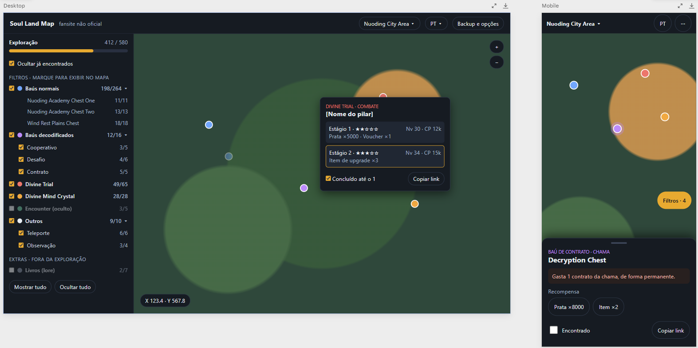

# Soul Land Map — MVP specification

Unofficial fansite for *Soul Land: New World* with interactive, MapGenie-style maps: filterable markers per
region and personal exploration progress. This file is the design reference. For what is built and what comes
next, read `docs/ROADMAP.md`. For how to run and feed the data pipeline, read `README.md`.

Where the implementation differs from this spec, the section "Implementation status" says so.

## 1. Principles

- 100% static site on GitHub Pages, open repository (portfolio).
- Plain HTML + JS ES modules + Leaflet 1.9.4 (vendored, no CDN), no framework or bundler for now. These
  are today's choices, each with the trigger to revisit it, in "Current decisions" in `CLAUDE.md`.
- Per-map JSON data, versioned in git. The collection spreadsheet (exported as CSV) is the source until the
  MVP is done; the JSON is generated from it by `tools/build_data.py`.
- YAGNI with honest trade-offs: add a tool or infrastructure when it makes the work easier or safer than it
  costs, not before.
- i18n from day one: `en` (default and fallback), `pt`, `zh`.
- Everything in the repo (code, comments, strings, docs) is in English, for future contributors.

## 2. Scope

In the MVP: region selector, filter sidebar with counters, detail popups, "found" tracking with hide-found,
per-map progress in localStorage with JSON backup/restore, language selector, deep links, mobile layout, and a
readout of the game coordinates under the cursor (validates calibration, helps debug data).

Out of the MVP: search, clustering (~300 markers per map do not need it), user notes/markers, editor mode,
exploration-points calculator, merchants and prices, access-tag filter, expected value of rewards, community
contributions (planned later via GitHub pull requests), cross-device sync. Lore books are in the MVP, without
the obligation of listing all of them at launch.

## 3. Repository layout

```text
index.html
favicon.svg, favicon.ico, apple-touch-icon.png   site icon (the .ico and .png from tools/make_favicon.py)
js/            ES modules: app, layers, sidebar, util (UI); model, trials, storage, i18n, geo (pure)
vendor/leaflet Leaflet 1.9.4 (committed, with its LICENSE)
css/
icons/         only the icons actually used (not created yet)
data/
  maps.json            image size, tile zooms, calibration
  categories.json      groups, types, placeholder color/glyph, countsForExploration
  entries/<map>.json   exploration-list entries (generated, CSV row order)
  markers/<map>.json   markers (generated)
  src/<map>/{markers,entries,marker_texts,stages}.csv   hand-collected source data
  calibration/<map>.json            known points used by tools/check_calibration.py
  (planned: items.json, loot.json)
i18n/
  languages.json, en.json, pt.json, zh.json      UI strings (flat keys)
  entries.<map>.<lang>.json                      entry names/descriptions (generated, always en/pt/zh)
  markers.<map>.<lang>.json                      marker names/notes/howtos (generated, always en/pt/zh)
  (planned: items.<lang>.json)
tiles/<map>/{z}/{x}/{y}.webp   generated offline by tools/make_tiles.py (committed)
maps/<map>.png  source map image, local only (ignored by git)
tools/         Python: build_data.py, check_calibration.py, make_tiles.py, make_favicon.py
tests/         unit tests for the pure js/ modules (node --test tests/), pipeline tests (test_*.py), browser test (browser.mjs)
docs/          SPEC.md, ROADMAP.md
```

## 4. Data model

### 4.1 Maps and calibration

`maps.json` per map: image width/height (4096 × 4096 for Nuoding), tile size 256, `maxNativeZoom` 4, `maxZoom` 5
(higher is blurry), and the calibration. Calibration is two independent linear equations without rotation:
`px = scaleX * x + offsetX`, `py = scaleY * y + offsetY`. For Nuoding: scale ±25/7 (3.5714285714), offsetX
428.5714285714, offsetY 3657.142857142, RMS error 0.37 px over 11 points. Game Y grows upward (like Leaflet
`CRS.Simple`), image pixel Y grows downward, hence the negative `scaleY`.

Markers store **game units, never pixels**, so fixing the calibration or the image never requires regenerating
markers and the data stays verifiable in-game. The in-game `[Location]` link walks the character exactly onto
the point, so a coordinate read on arrival is precise. There is no Z: the game has no floors and never puts two
points at the same X/Y; rare vertical areas (a cave under a plain) are disambiguated in the marker `note`.

### 4.2 Categories

The game's exploration UI has 6 categories, mirrored as top-level groups: Normal Chest (`chest_normal`),
Decryption Chest (`chest_coop`, `chest_challenge`, `chest_contract`), Divine Trial (`divine_trial`, counted per
stage), Divine Mind Crystal (`crystal`), Encounter (`encounter`), Other (`teleport`, `viewpoint`, `seed`).
Outside the game's checksum and the exploration bar: extras (`book`), auxiliary (`mechanism`, `portal`) and
Dragon Island (`boss`, `arena`). `categories.json` defines group → types, color, glyph and
`countsForExploration`.

### 4.3 Entries

An entry is a row of the game's exploration list. Fields: `id`, `type` (marker type of its members), `size`
(expected marker count, the `11/11` in the game), optional `tags`, official names/descriptions in i18n. Entry ids
are unique per map, not globally (the same slug may exist in two maps); identity is the pair (map, slug).
Normal chests are partitioned into entries, so `entry` is mandatory for `chest_normal`.

Nuoding: 20 normal-chest sets (sum 264), 16 decryption chests (4 cooperative, 6 Pillar of Empty Path, 6 Coffers,
each an entry of size 1), 6 crystal sets (sum 28), 5 encounters, 2 "Other" entries (Light Up! Teleport 6, Enjoy
the Scenery 4). Divine Trials are not in the game's list and have no entry. Tags: `grappling_hook`,
`purple_demon_eye`, `guarded`, `hidden`, `ghostly_trace` (a Tang Sect skill); filtering by tag is post-MVP but the data carries it. A marker may add
its own tags on top of its entry's (e.g. one Tang Sect Chest Two chest also needs the Grappling Hook); its
effective tags are the union. The sidebar shows entry tags; the popup shows the effective tags of the marker.

### 4.4 Marker common fields

`id` (immutable, assigned once, never reused, e.g. `nuoding-0142`; never derived from row, coordinate or type),
`type`, `x`, `y` (game units), `entry`, `entry_index` (position in the in-game answer's `[Location N]` order),
`links` (related marker ids, bidirectional in the UI), optional own `tags` (4.3), optional short `note` and `howto` (i18n texts from
`marker_texts.csv`: the note is always shown, the howto sits behind a "show solution" button). Normal chests
carry no reward; it comes from the category's default loot.

### 4.5 Marker types

- `chest_normal`: default loot table `normal_chest`.
- `chest_coop`: `players` 1–4; the mechanism is text. A few are tutorials of the mechanic, with the
  unlock button right next to the chest so one player can open them alone (`players: 1`).
- `chest_challenge`: Pillars of Empty Path jumping puzzle; the location leads to the chest; optional pillar
  position (`pillar_x`, `pillar_y`) drawn as a small pin tied to the chest by a dashed line when the popup is open.
  Optional `players` (empty = 1) for the rare challenge that needs help: in Nuoding, Pillar of Empty Path I has a
  button on each side of a cliff that raises moving platforms only while someone stands on it (`players: 2`, the
  button on the starting side as the pillar position).
- `chest_contract`: `contract` = wood | flame | frost (Dragonwood 3, Desolate Flame 2, Mysterious Frost 1 in
  Nuoding) and a cost; the popup warns the contract is permanently consumed.
- `crystal`: Divine Mind Crystal.
- `divine_trial`: section 4.6.
- `encounter`: section 4.7.
- `teleport`, `viewpoint`: each has its official point name as a `name` in `marker_texts.csv`, shown as the
  popup title instead of the entry name.
- `portal`: whirlpool to another map, field `to` (map id), auxiliary group.
- `seed`: Blue Silver Grass seed (Mixed Area), field `seed` = number the game shows on pickup (can differ from
  `entry_index`; both are stored).
- `mechanism`: magic mechanism near each seed that builds a bridge only with the right seed; `requires_seed`,
  linked to the seed; auxiliary group, outside counters.
- `book`: lore book, extras group. No entry: its official title is a `name` in `marker_texts.csv` and is the
  popup title.
- `boss`, `arena`: Dragon Island (4.9).

### 4.6 Divine Trial

One marker per pillar, `subtype` puzzle | combat, and a `stages` list. The game counts per stage (Nuoding: 65),
so the site's counter sums stages. Stages are sequential; progress is an integer (stages completed, e.g. 6/10)
entered directly by the user. `stars` 1–5; `level` and `cp` only for combat (puzzle assumes level 1, CP 0);
each stage has its own reward of 2–4 items; the pillar's theme name lives in marker i18n; stages have no name.
The popup highlights the next stage. Filtering by player level is post-MVP.

The site calls a stage a **layer**, as the game's exploration rules do (EN "layer", PT "camada", ZH 层). The
game's trial window says "Level 3 Reward" / "Recompensa do Nível 3" / 3层奖励 instead, but "level" would
clash with the player level. The trial window shows one stage at a time, and the texts it uses are a
reference, not the source of truth (several are poor translations):

| Concept | EN (game) | PT (game) | ZH (game) | Site EN / PT / ZH |
|---|---|---|---|---|
| Subtype, combat | Cycle Challenge | Desafio Cíclico | 循环挑战 | Combat / Combate / 循环挑战 |
| Subtype, puzzle | Decryption Gameplay | Mecânica de (cut off) | 解密玩法 | Puzzle / Quebra-cabeça / 解密玩法 |
| Required level | Level Requirement: 29 | Nível Atingir29 | 等级达到29解锁 | Min. level / Nível mín. / 等级要求 |
| Recommended CP | Recommended Rating: 24000 | Pontuação Rec.:24000 | 推荐评分:24000 | Rec. rating / Pont. rec. / 推荐评分 |

Difficulty has no name in the game: it is a row of four-pointed stars (✦), which the site shows as well.
The ZH terms are kept as they are; EN and PT use the site's own wording where the official one is unclear.

UI: the popup shows the layers done (e.g. 4/10) with a bar, and one row per layer (number, stars, and for
combat trials the minimum level and the recommended rating, "—" while unknown). Clicking a layer that is not
done marks it and the earlier ones (8 done, click 10: 10 done); clicking a done layer unmarks it and the later
ones (8 done, click 5: 4 done); a button marks all of them done (or resets a complete trial). A started trial shows a "4/10" badge next to its marker (hidden when zoomed out,
like the glyph); a complete trial counts as found (faded, removed by "hide found").

Source data: the marker row in `markers.csv`, the name as a `name` row in `marker_texts.csv` (built into
`i18n/markers.<map>.<lang>.json`) and the stages in `stages.csv` (one row per stage, columns `trial`, `stage`,
`stars`, `level`, `cp`; `cp` stays optional until it is collected). Rewards will be extra `stages.csv` columns once items exist (4.8).

```json
{ "id": "nuoding-0281", "type": "divine_trial", "subtype": "combat", "x": 386, "y": 786,
  "stages": [ { "stars": 1, "level": 25, "cp": 12000, "reward": [ { "item": "silver", "qty": 5000 } ] } ] }
```

(`reward` is planned, see 4.8; the build does not write it yet.)

### 4.7 Encounters

Hidden trigger quests. Answer formats in the game are not uniform (Andy's Dilemma gives one `[Location]` but the
real trigger, talking to the NPC repeatedly, is not in the text; Animal Protection has no links and describes
three cages, freed in any order; freeing the third one starts the encounter wherever the player is, so the
three cages are its points and the primary one is just where the pin sits). Fields: `points`
(list of x/y, counted once), the entry description (`desc_*` in `entries.csv`, the game's own text, always
visible), `howto` (own text in `marker_texts.csv`, behind a "show solution" button) and `reward`. The text of
the game's Answer button is not stored: its locations are the markers themselves, and anything else worth
keeping goes into the `howto`. Progress is by marker id.

### 4.8 Rewards, items and loot (not implemented yet)

A reward list accepts fixed (`item`, `qty`), independent random (`chance`) and exclusive choice (`oneOf` with
`weight` summing to 100, e.g. normal-chest Mind Method: 80% 2×R or 20% 1×SR). `loot.json` holds named tables;
all normal chests in all regions share one `normal_chest` table. A marker may override with `loot` (table name)
or inline `reward`. One fixed normal-chest reward is a random class equipment that scales with player level
(`{ item: class_equipment, qty: 1, scales: player_level }`); the MVP popup only says it varies. Level cut-offs
are unknown and low priority. `items.json` is the catalog (icon per item), names in `i18n/items.<lang>.json`
(~10–20 distinct items in Divine Trials plus crystals, contracts, Mind Methods). Rewards are considered
immutable in the game; if they change, edit a `loot.json` entry.

### 4.9 Dragon Island

One map without exploration, low priority. The game offers two lines with the same map and markers (Combat Zone,
open PvP; Safe Zone, no PvP): one marker file and a Combat/Safe toggle in the header, only on this map. Types:
`boss` (9 fixed respawns; field `species`) and `arena` (Ancient Tooth Peak, world-boss events). Same species
drop the same soul ring. A teleport near Silent Beach (Safe Zone) sits next to a whirlpool portal to Tian Dou
City Area. No checksum or exploration bar. Positions are collected in-game.

| Spawn location | Boss | Species |
| --- | --- | --- |
| Broken Tooth Reefs | Sly Supreme Orangutan | Supreme Orangutan |
| North Coast Beach | Combatant Diamond Mammoth | Diamond Mammoth |
| Thunder's Edge | Sly Mighty Kong Bear | Supreme Bear |
| West Coast Beach | Combatant Supreme Bear | Supreme Bear |
| East Coast Beach | Combatant Supreme Orangutan | Supreme Orangutan |
| South Coast Beach | Sly Supreme Orangutan | Supreme Orangutan |
| Hope Island | Sly Wolf Thief Leader | Wolf Thief |
| Soul Rest Island (north) | Combatant Wolf Thief Leader | Wolf Thief |
| Soul Rest Island (south) | Sly Diamond Mammoth | Diamond Mammoth |

The sidebar should filter by species; the popup lists the other locations of the same species.

## 5. i18n

- `en` is default and fallback per key. A manifest `i18n/languages.json` lists offered languages; only listed
  languages are detected (`?lang=` in any case, saved setting, `navigator.languages`) or shown, so the UI is never half
  translated.
- Data JSONs are language-neutral; all text is in i18n files keyed by id. Marker titles: the marker's own
  name (trials, books, teleports, viewpoints), else the entry name, else the type.
- The game's official English is inconsistent (Norton/Nuoding, Fugold/Floating Gold, Sunset Forest/Radiant
  Light Forest), so ids are independent of names, Chinese is the source of truth when available, and the site
  may correct official English (e.g. a stray final period in a trial name). The official PT is
  translated from Chinese and is not consistent with the English names; keep it as the game shows it.
- Official game terms (categories, regions, entry names) vs unofficial site UI translations; the ZH UI needs
  review by a native speaker.

## 6. Progress and localStorage

- Keys are prefixed and versioned: `slmap:v1:progress:<map>` (set of found marker ids),
  `slmap:v1:trials:<map>` (Divine Trial id → layers done, positive integers only) and `slmap:v1:settings`
  (lang, current map, hidden types per map, hide-found per map).
- Divine Trials are never in the found set. A trial id found there (marked found before layer progress
  existed) is moved to `trials` as complete when the map loads or a backup is imported.
- All reads/writes in try/catch; the site works with empty or unavailable storage.
- Backup JSON `{ app: "soul-land-map", version: 1, exportedAt, progress, trials }` with validation (not-json,
  not-a-backup, unsupported-version, malformed); import replaces after confirmation. `trials` (map → id →
  layers done) is optional, so older backups still import and the version stays 1.
- Stable ids make progress survive data updates; removed ids are ignored when reading. A breaking format
  change requires bumping the version and a migration; an optional new field does not.

## 7. Interface

MapGenie pattern: category sidebar with counters, full-screen map, popup with "mark as found". Dark theme.
Reference mockup (names/numbers are placeholders): <https://claude.ai/artifact/QPMqdzgamF5GHDXPeu8QMJ>



Desktop: top bar (title, map selector, language selector, sidebar toggle); left sidebar (~320 px, collapsible)
with the exploration bar, "hide found" toggle and filter tree; each group/type has a checkbox and a live
`found/total` counter; entry lists expand under their type and clicking an entry frames and highlights its
markers; extras and auxiliary groups are outside the exploration bar. Map: circular colored markers with a glyph
(real icons later), found markers become a gray dot with a check (or vanish with hide-found), coordinate readout
bottom-left, zoom control top-right. Markers shrink below the native zoom; under a threshold only a dot is shown.

Mobile (< 700 px): the sidebar is a drawer that starts closed; `100dvh`; `pointer: coarse` enlarges touch
targets (≥ 44 px). Planned: popup as bottom sheet.

Popup: title, type, description, note, type-specific fields, "found" button (or the layer list on Divine
Trials, 4.6), coordinates; planned: tags, rewards with icons, copy-link, howto behind a "show solution" button.
Popups open below the zoom buttons and scroll inside on short screens.

Deep link by simple hash, `#nuoding/nuoding-0142` (only a bare `#name` works on GitHub Pages; no routes or
query strings). Not implemented yet.

## 8. Data pipeline and validation

Flow: spreadsheet → CSV → `tools/build_data.py` → JSON + validation report (details and column tables in
`README.md`). Collection flow per entry: complete the entry in-game, use Answer to paste the `[Location N]`
text into chat, click each location (the character stops on the point), and record entry, entry_index, x, y
exactly as shown, without rounding. Crystals, special chests and sets follow the same flow. Trials, pillars,
mechanisms and encounter points are noted separately. In regions not completed yet the Answer only exists
once the entry is complete.

Before walking everything, a short time-boxed look (a few hours) at the game assets via AssetRipper for
position/localization tables is worthwhile; if found, a linear regression against a few hand-noted points
converts everything. Version only derived data, never raw dumps.

Validations: unique never-reused ids; known types; bounds; per-entry marker count ≤ size; category totals equal
the game's counters (Nuoding 264, 16, 65, 28, 5, 10); trial stage sum equals the game counter; `oneOf`
weights = 100, stars 1–5, non-decreasing levels; referenced items exist; links point to existing ids; seeds and
mechanisms consistent; id stability against the previous build. Implemented today: everything except the
category totals and stage sum against the game counters (the per-entry `size` covers most of it, and the stage
sum is printed) and the item/loot checks, which arrive with those features. The full list is in `README.md`.

## 9. Tiles and icons

The 4096² map image is extracted from game assets; `tools/make_tiles.py` (Pillow) makes 256 px WebP tiles at
zooms 0–4 (341 tiles). One ImageOverlay would be ~64 MB decoded on mobile and blurry beyond native zoom.
Markers: a few hundred per map, no clustering; switch to the canvas renderer only if slow. Icons: use the
small in-map marker sprites (not the large circular UI emblems), cropped and resized to 48–64 px with Pillow,
WebP/PNG, referenced from `categories.json` / `items.json` so they can be swapped without touching the rest.
Plan B: colored circle with a letter (the current placeholders).

## 10. Hosting and legal

GitHub Pages, public repo. Visible disclaimer: unofficial fansite, no affiliation with the game's rights
holders (`ui.disclaimer`, a footnote at the bottom of the sidebar; the ZH text names both the Chinese title
《斗罗大陆：史莱克学院》 and Soul Land: New World). Using game assets (map, icons) is a gray zone, common in
fansites, with no guarantee: version only what is needed, no raw dumps, remove anything on request. No
monetization, analytics or SEO in the MVP.

## 11. Reference data

- Nuoding City Area: Normal Chest 264, Decryption Chest 16, Divine Trial 65 stages (10 pillars), Divine Mind
  Crystal 28, Encounter 5, Other 10 (6 teleports + 4 viewpoints).
- Mixed Area of Xing Dou Forest: 172 / 9 / 12 / 20 / 2 / 14 (8 seeds + 6 teleports, no viewpoints).
- Planned regions: Nuoding City Area, Suotuo City Area, Xing Dou Great Forest, Tian Dou City Area, Sunset
  Forest, Mixed Area of Xing Dou Forest, City of Slaughter, Dragon Island. The first seven follow the same
  category pattern. Each region is fully separate, linked by portals with loading screens.
- Exploration value, from the game's rules popup (EN "Area Exploration", PT "Exploração da Área", ZH 区域探索;
  the points are EN "exploration points" / "exploration value", PT "valor de exploração", ZH 探索值). The
  popup's own wording for each item is in brackets; "essences" are the Divine Mind Crystals and "scenic spots"
  the viewpoints:

  | Item | Points | EN | PT | ZH |
  |---|---|---|---|---|
  | Chest (any) | +5 each | Opening treasure chests | Abrir baús de tesouro | 开启宝箱 |
  | Teleport point | +35 each | Activating Teleport Points | Ativar Pontos de Teletransporte | 激活传送点 |
  | Viewpoint | +35 each | Activating scenic spots | Ativar pontos panorâmicos | 激活观景点 |
  | Divine Mind Crystal | +10 each | Collecting essences | Coletar essências | 收集精粹 |
  | Divine Trial | +10 per layer | Completing divine trials (each layer counts as 1 trial in multi-layer challenges) | Concluir Provações Divinas (em desafios com várias camadas, cada camada conta como 1 provação) | 完成神意试炼（多层挑战时，每层算作1个试炼） |
  | Encounter | +80 each | Completing encounters | Concluir encontros | 完成奇遇 |

  Seeds are not in the list. Nuoding totals 3080 exactly; the Mixed Area's 240 reconciles only if a seed is
  +5. Reward milestones: 250/500/1000/1500/2000/2500 (Nuoding), 75/150/300/600/900/1200 (Mixed Area).

## 12. Decisions and open points

Decided: books in the MVP without completeness; equipment level cut-offs irrelevant; community data via GitHub
PR when there is interest; Leaflet vendored, no CDN or framework; the exploration bar counts only countable
categories; trial progress is a user-entered integer; a trial stage is called a "layer" on the site (4.6).

Open: final marker size/style per zoom (depends on real icons); official Chinese texts as source of truth
(later, non-blocking); Dragon Island positions (in-game collection).

## 13. Implementation status (differences from this spec)

- Done: tiles + calibrated map + readout; pipeline; sidebar with counters and entry lists; popups with found
  button; progress, hide-found and backup/restore; en/pt/zh with selector; responsive drawer layout; Nuoding
  fully mapped (337 markers); encounters with several points draw an icon on each point.
- Divine Trials: pipeline and UI done (4.6): layer list and progress in the popup, badge, counters per layer
  (65 in Nuoding). The build prints the stage sum but does not check it against the game counter (not stored
  anywhere yet). Most combat stages have no recommended CP yet. Stage rewards wait for items (4.8).
- Marker texts: `note` is shown in the popup; `howto` is built and validated but not shown yet.
- Tags: carried by entries and markers in the data; not shown or filterable on the site yet.
- Not yet: items/loot/rewards, howto button, tags on the site,
  `links` in the UI, the contract-consumed warning on `chest_contract`, deep links, copy-link, bottom-sheet
  popup, pillar line for `chest_challenge`, species filter, real icons,
  other regions.
- The exploration bar is count-based (found/total of countable groups, 388 in Nuoding with trials counted per
  layer), not points.
- Backup contains `progress` and `trials` (no settings).
- Entry order follows the CSV row order, not alphabetical.
